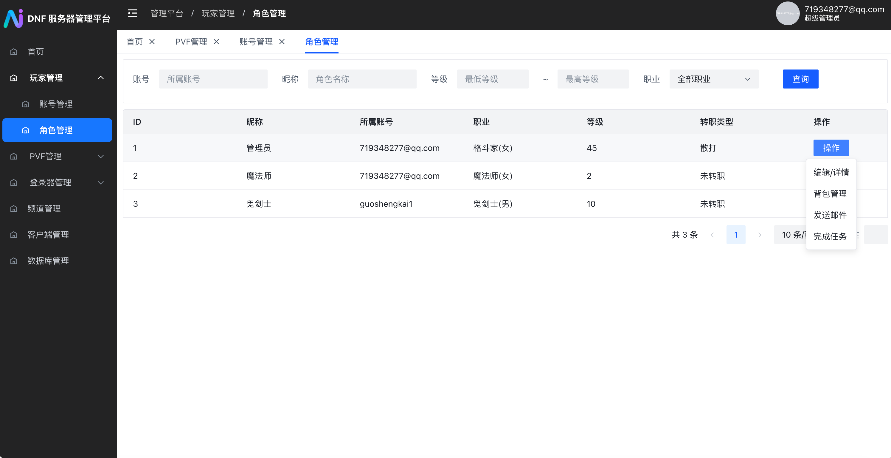
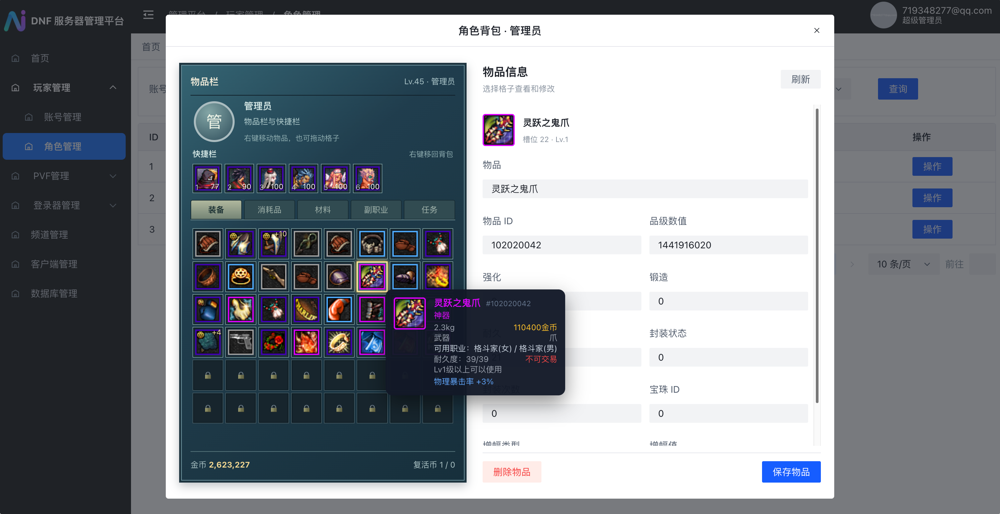
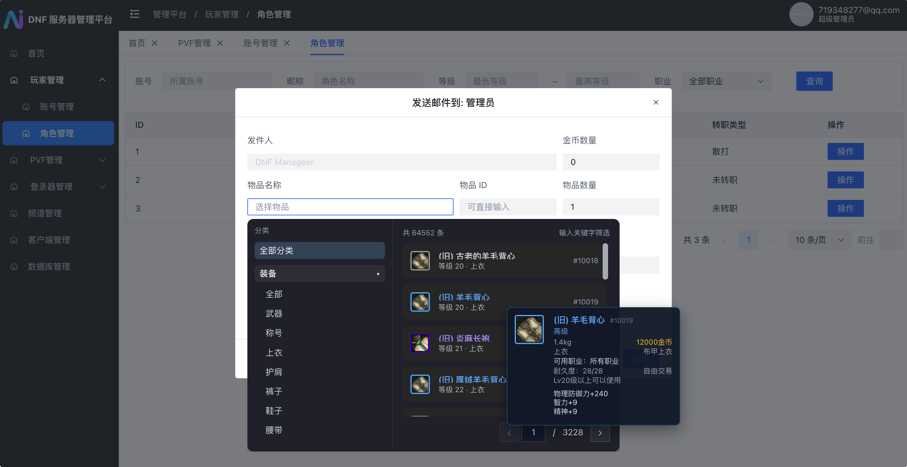
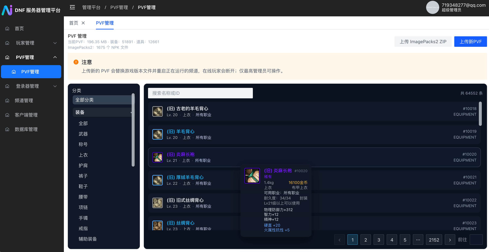
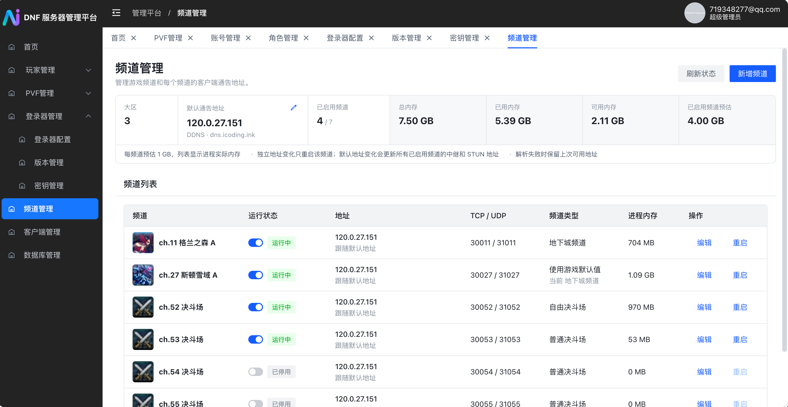
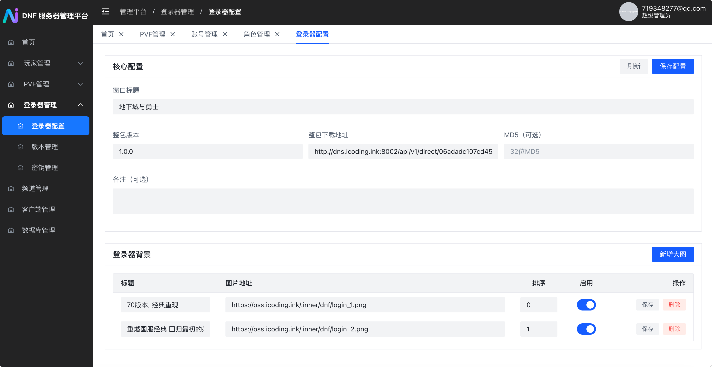
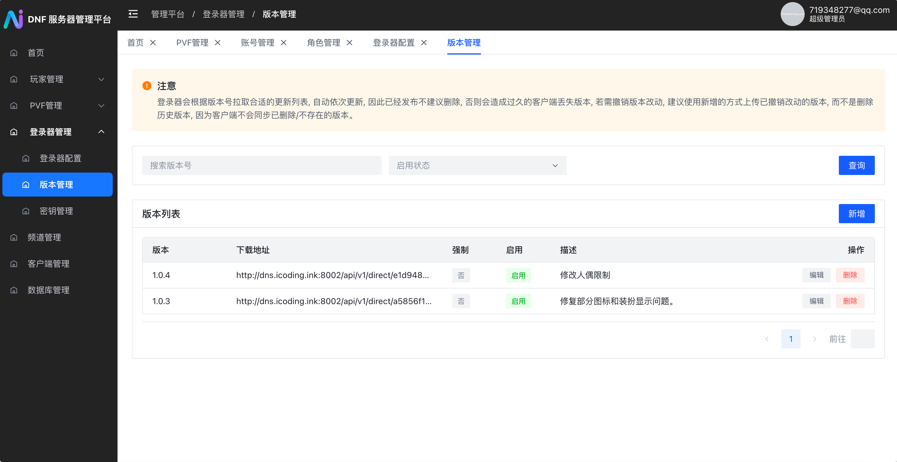
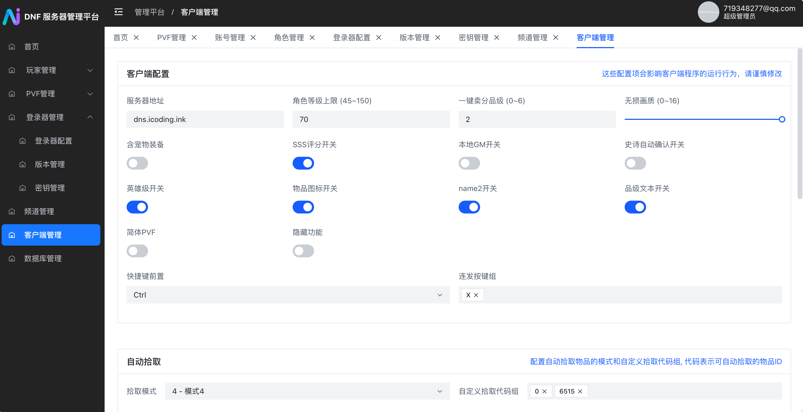
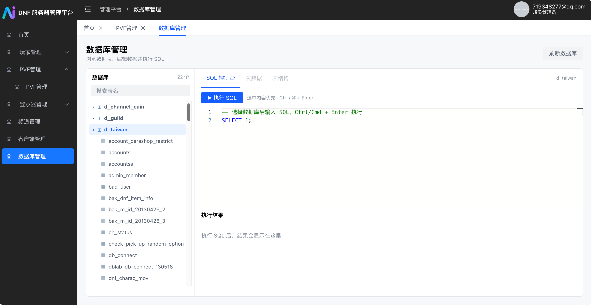

# DNF 服务器管理平台

DNF 服务器管理平台（简称**平台**）是一个开放的 Web 后台，用于管理 DNF 游戏服务（简称**服务**）。平台既提供 GM 日常运营功能，也覆盖服务运维、登录器、客户端配置和数据库管理，让运营人员通过统一界面完成常用操作。

平台和服务是独立项目：

- [DNF 服务](https://github.com/onlyGuo/dnf)：基于 [1995chen/dnf](https://github.com/1995chen/dnf) 的服务项目，提供集成平台的一体化镜像。
- [DNFLogin 登录器](https://github.com/onlyGuo/DNFLogin)：配套的客户端登录器，读取平台提供的登录器和版本配置。
- [PVF/NPK 解析器](https://github.com/onlyGuo/dnf_parser)：平台使用的资源解析项目。

## 更新进度

### 2026-11-05 · 文档维护

- 新增更新进度，补齐近期功能和镜像发布记录。后续每次提交同步追加对应记录。

### 2026-11-05 · 20261105-203131

- 增加在线完成任务。平台与服务同环境运行并加载任务组件时，后台可将已接任务实时推进到可交付状态，无需切换角色，已通过游戏内实测。
- 收集类任务继续通过邮件补发材料。执行前核对实时任务列表，任务状态变化时提示重试。
- 独立平台和一体化服务均已发布固定版本 `20261105-203131`，同步更新 `latest`。

### 2026-11-05 · 20261105-094955

- 修复后台发送邮件后需要重新选择角色的问题，在线角色可立即收到新邮件通知，已通过游戏内实测。
- 集成服务启动时自动加载通知组件，无需指定加载频道。平台显示通知结果，通知未确认时会给出提示。
- 统一镜像名称。`guoshengkai/dnf-server` 提供独立平台，`guoshengkai/dnf` 提供完整一体化服务，两个项目的部署说明同步更新。

## 快速开始

已有游戏服务和数据库时，可以单独启动平台。将下面的数据库地址、账号和密码改成实际值：

```bash
mkdir -p platform-data
docker run -d --name dnf-platform --restart unless-stopped \
  -p 8003:80 \
  -e 'SPRING_DATASOURCE_URL=jdbc:mysql://数据库地址:3000/dnf_service?useUnicode=true&characterEncoding=utf8&autoReconnect=true' \
  -e 'SPRING_DATASOURCE_USERNAME=数据库用户名' \
  -e 'SPRING_DATASOURCE_PASSWORD=数据库密码' \
  -v "$PWD/platform-data:/app/data" \
  guoshengkai/dnf-server:latest
```

打开 `http://服务器地址:8003/login`。没有超管时，已有的第一个账号会被设为超管；空账号库的第一个注册账号会成为超管。

想一次启动整套游戏服务？使用 [DNF 一体化服务的快速开始](https://github.com/onlyGuo/dnf#快速开始)。数据库连接和相应端口的防火墙策略请按自己的部署环境配置。

平台容器内 Nginx 默认监听 80，Java 服务默认监听 9001，可分别通过 `NGINX_PORT` 和 `SERVER_PORT` 调整。

游戏登录授权还需要与服务公钥匹配的现有私钥：可放入挂载目录的 `private.key`，或将私钥挂载进容器并通过 `DNF_PRIVATE_KEY_PATH` 指向容器内的路径。独立平台不会自动生成与服务无关的密钥。

容器首次启动时默认只添加缺失的数据库表和字段，不执行 `init.sql` 中的 `DROP` 或示例数据插入；设置 `DNF_DB_AUTO_INIT=false` 可关闭初始化。不要直接对已有数据库执行完整的 `init.sql`。

## 部署方式

| 方式 | 可用能力 |
| --- | --- |
| 平台单独运行或单独使用 Docker | 连接已有游戏数据库，管理账号、角色、邮件等数据库功能；未发现服务时，文件和进程管理不可用。 |
| 平台与服务部署在同一宿主机 | 平台发现服务目录和 Supervisor 后，还可管理频道、PVF 和密钥。 |
| 平台与服务集成在同一个容器 | 一个容器运行整套服务和平台，可使用上述服务管理功能。 |

仅让独立平台容器使用 `host` 网络并不会自动共享宿主机的文件或进程。要管理服务，还需要平台能访问对应目录及 Supervisor；不需要给平台挂载 Docker socket。

## 功能预览

### 玩家、角色与邮件

管理账号、角色属性、任务和游戏邮件；发送物品时可按名称、分类或 ID 查找，并查看物品属性。受支持的一体化服务会向在线角色发送新邮件通知，无需重新选择角色。角色背包与快捷栏可以同时查看和编辑；编辑前需要退出游戏，避免游戏内存与数据库互相覆盖。







### PVF 与物品图标

从服务目录读取 `Script.pvf`，浏览装备和道具属性。超管可上传新 PVF：校验成功后更新服务文件及已有持久化副本，并重启运行中的频道。

物品图标从 `data/ImagePacks2` 中的 NPK 读取。上传 ZIP 时，既支持压缩包包含 `ImagePacks2/` 文件夹，也支持直接包含文件夹内的内容；新 NPK 校验成功后替换旧资源并立即生效。



### 频道与动态地址

在页面新增、编辑、启用、停用和重启频道；默认通告地址和各频道地址可分别使用固定 IPv4 或 DDNS。页面显示总内存、已用内存、频道进程占用以及每频道约 1 GB 的预估。

频道类型可选择游戏默认值、地下城、交易、亡者峡谷、普通决斗场、自由决斗场或公平决斗场；指定类型时只更新运行状态表。单个频道地址变化时只重启该频道，无需重启容器或重新启动整套服务。默认地址影响共用中继和 STUN 地址，因此变化时还会重新加载相关公共进程和已启用频道。



### 登录器与客户端配置

在平台配置登录器标题、背景、整包下载地址和版本更新列表，配套登录器根据配置获取更新。客户端配置集中管理服务器地址、等级上限、画质、自动拾取等选项，并由配套客户端读取；具体生效范围取决于客户端实现。







### 数据库与密钥

超管可浏览数据库和表、查看结构、编辑表数据并执行 SQL。密钥管理支持上传匹配的 RSA 公私钥对或重新生成 2048 位公私钥，并同步平台和服务的密钥；更换后会重启运行中的相关进程。



账号权限由后台控制：`admin=2` 为超管、`1` 为 GM、`0` 为普通玩家。普通注册不接受客户端提交的管理员权限；首次初始化管理员按平台规则处理。管理员也可以使用登录器作为普通玩家进入游戏。

## 已发布镜像

| 镜像 | 用途 | 已发布架构 |
| --- | --- | --- |
| `guoshengkai/dnf-server:latest` | 独立平台 | `linux/amd64` |
| `guoshengkai/dnf:latest` | 集成平台的服务 | `linux/amd64` |

```bash
docker pull guoshengkai/dnf-server:latest
docker pull guoshengkai/dnf:latest
```

固定版本和发布信息见 Docker Hub 的[平台镜像](https://hub.docker.com/r/guoshengkai/dnf-server)和[一体化服务镜像](https://hub.docker.com/r/guoshengkai/dnf)。集成镜像的完整 `docker run`、宿主机防火墙和新增频道端口示例见 [服务项目 README](https://github.com/onlyGuo/dnf) 和 [集成部署说明](deploy/integrated/README.md)。

## 与服务一起运行

平台与服务同机或同容器运行时，按以下路径发现服务：

| 环境变量 | 用途 | 默认值 |
| --- | --- | --- |
| `DNF_GAME_DIR` | 服务运行目录，包含 `Script.pvf` 和游戏公钥 | `/home/neople/game` |
| `DNF_DATA_DIR` | 服务持久化数据目录 | `/data` |
| `DNF_SUPERVISORCTL` | 服务进程管理命令 | `/usr/local/bin/supervisorctl` |
| `DNF_CHANNEL_DDNS_INTERVAL_MS` | 频道 DDNS 刷新间隔 | `10000` |

管理进程需要具备访问这些目录和 Supervisor 的权限。集成服务镜像在宿主机网络模式下默认通过 **8003** 提供平台；桥接模式下容器内平台端口为 9001。更换 PVF 或密钥会断开受影响频道的在线玩家。

平台数据目录应持久化 `private.key`、`ImagePacks2` 和初始化标记。旧版 `data/imagepacks-uploads` 中的当前资源会在启动时尝试迁移到 `ImagePacks2`，旧目录不会自动删除。

## 从源码构建与宿主机运行

需要 Node.js 22、Java 17 或更高版本及 Maven：

```bash
cd webui2
npm ci
npx vite build
cd ..
mvn -Dmaven.test.skip=true package
```

生成的 `target/dnf-server-0.0.1-SNAPSHOT.jar` 包含平台页面，默认监听 9001。构建不会将源码目录中的旧私钥文件打入新 JAR。

在服务所在宿主机运行时，可在项目目录中配置数据库和服务路径：

```bash
export SPRING_DATASOURCE_URL='jdbc:mysql://127.0.0.1:3306/dnf_service?useUnicode=true&characterEncoding=utf8&autoReconnect=true'
export SPRING_DATASOURCE_USERNAME='数据库用户名'
export SPRING_DATASOURCE_PASSWORD='数据库密码'
export DNF_GAME_DIR=/home/neople/game
export DNF_DATA_DIR=/data
export DNF_SUPERVISORCTL=/usr/local/bin/supervisorctl
```

按实际环境修改数据库地址、凭据和路径。将与游戏公钥匹配的现有私钥放到运行目录的 `data/private.key`，或通过 `DNF_PRIVATE_KEY_PATH` 指定。

JAR 直接运行时不会执行 Docker 入口脚本的数据库初始化。首次安装且数据库尚未包含平台表和字段时，可使用 Python 3 与 MySQL 客户端生成增量 SQL，检查后应用。下面以本机 3306 和 `dnf_service` 数据库为例：

```bash
export DNF_DB_INIT_HOST=127.0.0.1 DNF_DB_INIT_PORT=3306 DNF_DB_INIT_NAME=dnf_service
export DNF_DB_INIT_USER="$SPRING_DATASOURCE_USERNAME"
export DNF_DB_INIT_PASSWORD="$SPRING_DATASOURCE_PASSWORD"
export DNF_INIT_SQL="$PWD/init.sql"
python3 deploy/integrated/init_db.py > /tmp/dnf-platform-init.sql
# 检查生成的 SQL 后执行：
MYSQL_PWD="$DNF_DB_INIT_PASSWORD" mysql -h "$DNF_DB_INIT_HOST" -P "$DNF_DB_INIT_PORT" -u "$DNF_DB_INIT_USER" < /tmp/dnf-platform-init.sql
unset DNF_DB_INIT_PASSWORD
```

准备好数据库、密钥及服务路径后启动，访问 `http://服务器地址:9001/login`：

```bash
java -jar target/dnf-server-0.0.1-SNAPSHOT.jar
```

本地模拟说明见 [deploy/local-sim/README.md](deploy/local-sim/README.md)，邮件通知细节见 [doc/online-mail.md](doc/online-mail.md)。
